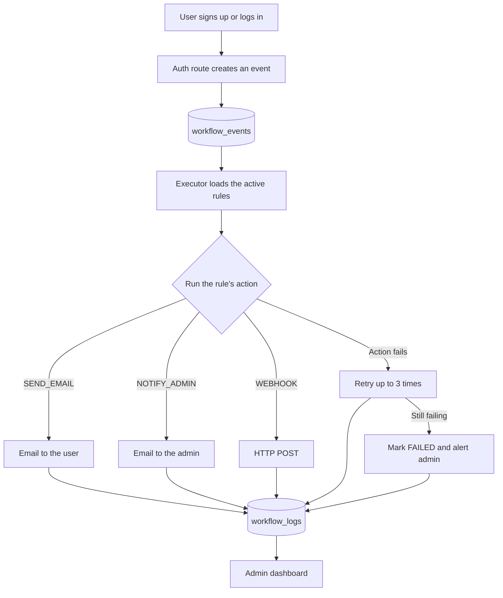

# Workflow Automation (WFA)

An event-driven workflow automation platform in the spirit of Zapier or n8n, built from scratch with Node.js, Express and PostgreSQL. When something happens in the system (a user signs up, a user logs in), the engine finds the matching rules, performs each rule's configured action for real (sends an email, calls a webhook, alerts an admin), retries failures, and records the true outcome on an admin dashboard.

> **Status:** runs locally. A hosted demo is not available yet. See [Screenshots](#screenshots) for the UI.

---

## Table of contents
- [Features](#features)
- [Tech stack](#tech-stack)
- [How it works](#how-it-works)
- [Project structure](#project-structure)
- [Getting started](#getting-started)
- [Environment variables](#environment-variables)
- [Defining rules](#defining-rules)
- [API reference](#api-reference)
- [Security](#security)
- [Screenshots](#screenshots)
- [Known limitations](#known-limitations)
- [Roadmap](#roadmap)
- [Author](#author)

---

## Features

**Authentication and access control**
- Open signup and login with **bcrypt**-hashed passwords and **JWT** sessions (1 hour expiry)
- Two roles, `user` and `admin`, each with its own page after login
- Admin-only API routes enforced **on the server**, not only hidden in the browser
- Rate limiting on `/auth/login` and `/auth/signup`

**Event-driven workflow engine**
- Events (`USER_SIGNUP`, `USER_LOGIN`) are stored in the database and processed by rules
- Each rule runs a real action:
  - `SEND_EMAIL`: sends an email, with the recipient and text filled from templates such as `{{user.email}}`
  - `NOTIFY_ADMIN`: emails the administrator
  - `WEBHOOK`: sends an HTTP POST with the event and user data
- **Retries:** a failed action is attempted up to 3 times, with a growing wait between attempts (2 s, then 4 s)
- A rule that still fails after 3 attempts is marked `FAILED` and the admin is emailed
- One failing rule never blocks the other rules or a user's login

**Notifications**
- Welcome email to every new user at signup
- Admin email for new accounts, successful logins and final workflow failures
- Email failures are logged and never break signup or login

**Admin dashboard**
- Status cards and a doughnut chart for `SUCCESS`, `RETRYING`, `FAILED`
- Recent activity feed showing the **real outcome** of each run, for example `Rule 1: Email sent to user@example.com` or `Rule 39: fetch failed (attempt 3/3)`
- Auto-refresh every 15 seconds

---

## Tech stack

| Layer | Technology |
|---|---|
| Backend | Node.js 18+, Express |
| Database | PostgreSQL (`pg`) |
| Auth | JSON Web Tokens (`jsonwebtoken`), `bcrypt` |
| Email | Nodemailer (SMTP) |
| Security | `express-rate-limit`, `cors`, `dotenv` |
| Frontend | HTML, CSS, vanilla JavaScript, Chart.js |

---

## How it works



1. A route creates an event row, for example `USER_LOGIN` for user 5.
2. The executor loads every **active** rule for that event name.
3. For each rule it picks the action handler, fills in the templates, and runs it.
4. Each attempt writes a row to `workflow_logs` with the real message, the status (`SUCCESS`, `RETRYING` or `FAILED`), the rule id and the attempt number.
5. The dashboard reads only the rows that come from rule executions.

Events run in the background, so a slow or failing action never delays the login response.

---

## Project structure

```
Workflow_Automation/
├── db/
│   └── index.js            PostgreSQL connection pool
├── frontend/
│   ├── index.html          Admin dashboard
│   ├── user.html           Normal user page
│   ├── login.html          Login page
│   ├── signup.html         Signup page
│   ├── script.js           Dashboard logic
│   ├── auth-guard.js       Client-side redirect helper
│   ├── auth.css            Login / signup / user page styles
│   └── style.css           Dashboard styles
├── middlewares/
│   ├── auth.js             Verifies the JWT
│   └── role.js             Checks the user's role
├── routes/
│   ├── auth.js             Signup and login
│   ├── metrics.js          Dashboard data (admin only)
│   ├── users.js            Admin only
│   ├── events.js           Admin only
│   ├── rules.js            Admin only
│   └── logs.js             Admin only
├── services/
│   ├── mailer.js           Email sending
│   ├── ruleEngine.js       Rule matching
│   └── workflowExecutor.js Runs actions, retries, writes logs
├── scripts/                One-time helper scripts
├── sql/
│   └── schema.sql          Database structure
├── .env.example            Template for your own .env
├── index.js                Server entry point
└── package.json
```

---

## Getting started

### Prerequisites
- Node.js 18 or newer (the code uses the built-in `fetch`)
- PostgreSQL 13 or newer
- An email account that can send through SMTP (for example a Gmail account with an App Password)

### 1. Clone and install
```bash
git clone https://github.com/<your-username>/<your-repo>.git
cd <your-repo>
npm install
```

### 2. Create the database
```bash
createdb workflow_automation
psql -d workflow_automation -f sql/schema.sql
```
You can also create the database in pgAdmin and run `sql/schema.sql` in its Query Tool.

### 3. Configure the environment
```bash
cp .env.example .env
```
Open `.env` and fill in your own values. See [Environment variables](#environment-variables).

### 4. Start the server
```bash
npm start
```
Open **http://localhost:3000**. It shows the login page.

### 5. Create an admin account
Signup always creates a normal `user`, so nobody can make themselves an admin through the form. Promote one account in the database:

1. Sign up through the website.
2. Run:
   ```sql
   UPDATE users SET role = 'admin' WHERE email = 'you@example.com';
   ```
3. Log out and log in again. You will land on the dashboard.

### 6. Add rules
The engine does nothing until rules exist. See [Defining rules](#defining-rules).

---

## Environment variables

| Variable | Purpose |
|---|---|
| `PORT` | Server port (default `3000`) |
| `JWT_SECRET` | Secret used to sign login tokens. Use a long random value |
| `DB_HOST`, `DB_USER`, `DB_PASSWORD`, `DB_NAME`, `DB_PORT` | Local PostgreSQL connection |
| `DATABASE_URL` | Full connection string. If set, it is used instead of the `DB_*` values |
| `SMTP_HOST`, `SMTP_PORT` | Mail server, for example `smtp.gmail.com` and `587` |
| `SMTP_USER`, `SMTP_PASS` | The sending account. For Gmail, `SMTP_PASS` must be an App Password |
| `MAIL_FROM` | Sender shown to recipients, for example `"Workflow Automation <you@gmail.com>"` |
| `ADMIN_EMAIL` | Where admin notifications are delivered |

Generate a strong secret with:
```bash
node -e "console.log(require('crypto').randomBytes(48).toString('hex'))"
```

> `.env` is listed in `.gitignore`. Never commit it.

> **Hosting note:** some free hosting plans block outgoing SMTP ports. If you deploy on one, replace `services/mailer.js` with an HTTPS email API (Brevo, Resend and similar). The rest of the code only needs `sendMail` and `notifyAdmin` to be exported.

---

## Defining rules

A rule belongs to an event, has an `action_type`, and carries its settings in `action_config` (JSON). Templates `{{user.name}}`, `{{user.email}}` and `{{event.name}}` are filled in at run time.

**Email the user at login**
```sql
INSERT INTO workflow_rules (event_name, action, action_type, action_config, is_active)
VALUES ('USER_LOGIN', 'LOGIN_ALERT', 'SEND_EMAIL',
  '{"to":"{{user.email}}","subject":"Login alert","text":"Hi {{user.name}}, you just logged in."}',
  true);
```

**Notify the admin**
```sql
INSERT INTO workflow_rules (event_name, action, action_type, action_config, is_active)
VALUES ('USER_LOGIN', 'ADMIN_ALERT', 'NOTIFY_ADMIN',
  '{"subject":"Login event","text":"{{user.name}} ({{user.email}}) triggered {{event.name}}"}',
  true);
```

**Call a webhook**
```sql
INSERT INTO workflow_rules (event_name, action, action_type, action_config, is_active)
VALUES ('USER_SIGNUP', 'WEBHOOK_DEMO', 'WEBHOOK',
  '{"url":"https://example.com/hook"}', true);
```

Set `is_active = false` to switch a rule off without deleting it.

**Trying the retry logic:** create a `WEBHOOK` rule with an unreachable URL, log in once, and watch the dashboard show `RETRYING` twice and then `FAILED`. The admin receives a failure email.

---

## API reference

| Method | Endpoint | Access | Description |
|---|---|---|---|
| POST | `/auth/signup` | Public, rate limited | Create a `user` account |
| POST | `/auth/login` | Public, rate limited | Returns a JWT and the user's role |
| GET | `/metrics` | Admin | Totals for events, rules, logs and failures |
| GET | `/metrics/status-summary` | Admin | Count of runs per status |
| GET | `/metrics/recent-activity` | Admin | The 10 most recent rule runs |
| ANY | `/users`, `/events`, `/rules`, `/logs` | Admin | Management routes |
| GET | `/health` | Public | Health check |

Protected routes expect the header `Authorization: Bearer <token>`.

| Request | Result |
|---|---|
| No token | `401` |
| Valid token, role is `user` | `403` |
| Valid token, role is `admin` | `200` |

---

## Security

- Passwords are hashed with bcrypt and never stored or returned in plain text
- Login errors are generic (`Invalid email or password`), so attackers cannot tell which emails exist
- JWTs expire after one hour
- Role checks run in server middleware, not only in the browser
- Login and signup are rate limited per IP
- Secrets live in `.env`, which is excluded from Git
- Log text is escaped before it is shown on the dashboard

---

## Screenshots

Add your images to `docs/screenshots/` and keep these file names, or change the paths.

| Admin dashboard | Rule execution with retries |
|---|---|
| [Admin dashboard]
 

| Signup | Login |
|---|---|
| [Signup page]
| [Login page]
|

| Welcome email | Admin notification email |
|---|---|
| [Welcome email]
 | [Admin email]

 |

---

## Known limitations

These are known gaps, listed openly:

- **Retries are in-process.** Waiting between attempts happens inside the running server. If the server restarts mid-retry, that run is lost. A job queue would fix this.
- **Rules match on the event name only.** The `condition_json` column exists, but conditions are not evaluated yet.
- **No email verification.** Anyone can sign up with any address, which means a welcome email can reach someone who did not ask for it.
- **No automated tests yet.**
- **The JWT is kept in `localStorage`,** which is simple but exposed to XSS. HTTP-only cookies would be safer.
- **Admin accounts are created by a manual SQL update.**
- **No public hosted demo.**

---

## Roadmap

- [ ] Persistent job queue so retries survive a restart
- [ ] Evaluate `condition_json` (for example, only run when `role == ADMIN`)
- [ ] Email verification at signup
- [ ] Unit and integration tests for auth, role checks and the retry logic
- [ ] Admin UI to create, edit and disable rules
- [ ] More actions (Slack, SMS) and more event types
- [ ] Deployment with a hosted database and an HTTPS email provider

---

## Author

**Tharunika**
GitHub: [@your-username](https://github.com/your-username)

Built as a learning project to understand event-driven design, authentication, role-based access control and reliable background work in a Node.js backend.
